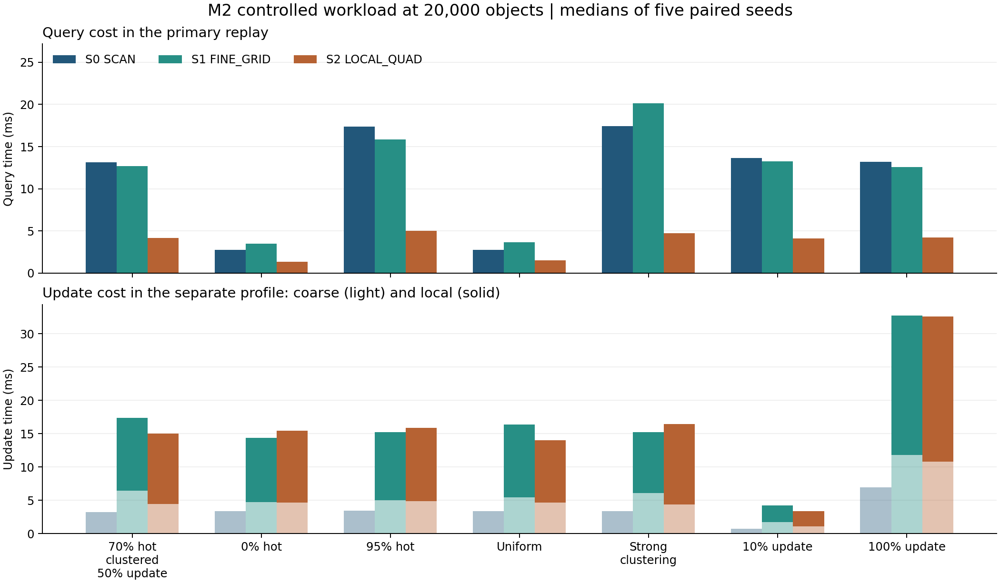

# M2 区域混合空间索引实验

2026-11-10。基于 M1 提交 `da9fbc3`，保留原始 M1 结果。M2 增加了三种区域模式、单线程同步切换和两套独立计时路径。

## 实现与正确性

- `AdaptiveRegionalIndex` 以 16×16 逻辑粗格划分区域。粗格成员表只为用到的区域分配，权威表保存对象坐标、区域和槽位。局部网格和四叉树保存由权威表维护的辅助检索记录。固定边缘区域接管参考矩形之外的点。
- 跨区更新先完成权威记录和成员关系修改，再同步更新相应的辅助索引。查询遍历包围盒覆盖的粗格，各模式采用 M1 的闭边界精确谓词。每个对象只属于一个区域。
- 切换先构建目标索引，再替换并释放旧索引。构建失败时原模式仍可使用。切回 SCAN 后释放辅助结构，后续位置变更只维护权威表和粗格。
- C++ 测试覆盖三种固定模式、混合跨区查询、跨区域移动、插删、网格与查询边界、浮点回归、停用后局部更新归零，以及 60,000 次随机混合操作。四种经典索引的 M1 测试一并重跑。2,000 对象动态诊断另外完成 24 次实际切换，累计 0.729 ms，864 次查询全部与暴力扫描一致。[C++ 日志](results/m2/build-and-tests.log) · [Python 日志](results/m2/python-tests.log) · [动态诊断](results/m2/controlled_2k/switch_diagnostic.csv)

## 实验口径

- S0 全 SCAN、S1 全 FINE_GRID、S2 全 LOCAL_QUAD，与 Uniform Grid、PR Quadtree、Boost R*-Tree 和 libspatialindex R*-Tree 共用每条事件序列。测试种子为 101、203、307、409、503。每个可调方法使用四个参数候选，各计时五次，以独立验证轨迹的在线耗时中位数选型。20,000 对象组在参考负载上锁定参数，其余六种负载复用这套参数。
- 主回放测量初始构建、查询和变更延迟、更新吞吐、峰值 RSS 与端到端耗时。三种区域方法的粗网格和局部维护时间来自第二次剖析回放，主回放关闭这层计时。两次运行分别记录在线总耗时，分项与主回放总耗时不可直接加总。动态诊断的显式切换计时包含目标构建和旧索引释放。
- 区域表按种子、阶段、区域与方法记录窗口末实体数、模式、查询量和频率、更新触达量、局部更新量、查询时间、局部维护时间、局部构建时间和切换次数。查询量按包围盒触达计数，包含空格。跨区移动可在两个区域各计一次触达。在线惰性构建时间已计入维护，显式切换构建已计入切换。初始构建单列一行。
- Windows 11，i7-13650HX，单线程固定逻辑 CPU 0，GCC 13.2.0，Boost 1.82.0，libspatialindex 1.9.3，`-std=c++20 -O3 -DNDEBUG`。端到端时间排除轨迹读取及独立校验。RSS 包含已载入的公共轨迹。两个 R*-Tree 的节点访问量留空。粗格访问、网格探测和四叉树节点检查的含义各有不同。[环境记录](results/m2/tdrive/environment.json)

## T-Drive 原生窗口

复用 M1 的 2008-02-03 08:00–09:00 窗口。峰值 1,306 个索引对象、13,966 条 GPS 记录、每种子 7,200 条人工查询。每个算法的逐种子输入哈希与其他方法一致。

| 方法 | 初始构建 ms | 查询合计 ms | P50 / P95 / P99 μs | 基础更新 ms | 局部更新 ms | 在线 ms | 更新 / 秒 | RSS MiB |
| --- | ---: | ---: | --- | ---: | ---: | ---: | ---: | ---: |
| S0 SCAN | 0.161 | 2.638 | 0.2 / 1.4 / 3.4 | 0.550 | 0.000 | **3.623** | 24,724,919 | 8.027 |
| S1 FINE_GRID | 0.525 | 3.853 | 0.2 / 1.8 / 5.6 | 0.679 | 1.652 | 6.447 | 6,850,994 | 8.430 |
| S2 LOCAL_QUAD | 0.345 | **2.277** | 0.1 / 1.1 / 3.0 | 0.652 | 1.098 | 4.260 | 9,583,275 | 8.305 |
| Uniform Grid | 0.270 | 3.816 | 0.2 / 1.6 / 3.3 | 1.314 | 0.000 | 5.517 | 11,017,465 | 8.098 |
| PR Quadtree | 0.351 | 2.565 | 0.2 / 1.0 / 1.9 | 3.460 | 0.000 | 6.431 | 4,018,820 | 8.398 |
| Boost R*-Tree | 1.732 | 3.413 | 0.4 / 1.1 / 2.2 | 9.129 | 0.000 | 12.975 | 1,540,392 | 8.191 |
| libspatialindex R*-Tree | 8.681 | 37.137 | 3.5 / 12.6 / 35.9 | 228.761 | 0.000 | 266.162 | 60,608 | 8.629 |

以上为五种子逐列中位数。经典索引的基础更新列为主回放变更时间，包含其全局索引维护。三种区域模式的基础和局部更新列来自剖析回放。固定策略切换为零。S2 查询合计比 S0 少 0.361 ms，剖析观察到 1.098 ms 的局部维护。S0 的主回放在线耗时最低，经典方法中 Uniform Grid 最低。本比较限于该窗口和查询分布。[逐种子 CSV](results/m2/tdrive/metrics.csv) · [配对统计](results/m2/tdrive/summary_native.json)

## 受控冷热负载

2,000 对象功能组按参考负载运行。五种子在线中位数中，经典 PR Quadtree 和 Uniform Grid 为 1.750 和 1.758 ms，区域 S0、S1、S2 分别为 1.940、2.866、1.925 ms。[2,000 对象 CSV](results/m2/controlled_2k/metrics.csv)

20,000 对象组是独立的纯合成实验。参考设定为 70% 热点、聚类、50% 更新，在参考上分别改变热点比例到 0% 和 95%、实体分布到均匀和强聚类、更新比例到 10% 和 100%。每个设定包含固定热点、热点迁移、冷热交替三个阶段，每阶段两步，每步 144 条查询。强制热点中心与全域均匀背景分开生成，最终强制热点比例因整数条数取整。热点坐标、查询比例、运动规则与配对种子已登记。单因素设计和短阶段适合测成本变化，交互作用与长期稳态仍待验证。[有效配置](results/m2/controlled_20k/config.json) · [热点与轨迹清单](results/m2/controlled_20k/trace_manifest.json)

20,000 对象的在线总耗时如下，单位为 ms，取五个配对种子的中位数。每个种子执行 864 次查询，10%、50%、100% 更新负载分别包含 12,000、60,000、120,000 次位置更新。

| 负载 | S0 SCAN | S1 FINE_GRID | S2 LOCAL_QUAD | Uniform Grid | PR Quadtree | Boost R*-Tree | libspatialindex R*-Tree |
| --- | ---: | ---: | ---: | ---: | ---: | ---: | ---: |
| 70% 热点，聚类，50% 更新 | 17.691 | 26.417 | 18.519 | **15.302** | 16.597 | 81.420 | 2,302.994 |
| 0% 强制热点 | **7.435** | 15.872 | 15.036 | 9.021 | 14.180 | 78.673 | 2,162.540 |
| 95% 强制热点 | 22.101 | 29.942 | 19.933 | 18.910 | **17.506** | 83.407 | 2,392.260 |
| 均匀实体 | **7.425** | 16.568 | 13.666 | 9.568 | 12.976 | 65.693 | 1,927.780 |
| 强聚类 | 21.912 | 30.817 | 20.938 | **17.527** | 19.697 | 100.351 | 2,522.161 |
| 10% 更新 | 14.623 | 16.907 | 7.367 | 9.706 | **6.038** | 25.027 | 608.698 |
| 100% 更新 | **22.062** | 38.539 | 31.850 | 23.691 | 29.825 | 157.178 | 4,390.776 |

[逐种子指标 CSV](results/m2/controlled_20k/metrics.csv) · [逐区域 CSV](results/m2/controlled_20k/regions.csv) · [分阶段成本](results/m2/analysis/regional_cost_by_phase.csv)

### 区域选型观察

- **SCAN** 在无强制热点、实体均匀和 100% 更新的全局回放里耗时最低。逐区剖析中，8,573 个有更新但没有查询的窗口没有从辅助索引获得查询收益。SCAN 的辅助维护累计为零，FINE_GRID 和 LOCAL_QUAD 分别为 118.242 和 120.173 ms。这两个累计值来自多次独立剖析。
- **FINE_GRID** 在本轮没有取得整组最低在线耗时。在有实体或更新的区域窗口中，仅 4 个窗口的“查询＋局部维护”成本独占最低。无强制热点组的一个窗口有 254 个期末对象、4 次查询触达、289 次更新触达，FINE_GRID 为 0.0446 ms，略低于 LOCAL_QUAD 的 0.0482 ms 和 SCAN 的 0.0770 ms。其余几个差距接近计时粒度，本轮未观察到可直接用于部署的稳定优势区间。
- **LOCAL_QUAD** 在 95% 热点、强聚类、10% 更新这三组的区域策略里最低。在 65–256 个期末对象、查询与更新触达比大于 1 的窗口中，LOCAL_QUAD 在 47 个配对窗口中的 46 个成本最低。该比值降到 0.1 以下时，SCAN 在同密度段 2,594 个窗口中的 2,592 个成本最低。
- **成本反转** 最明显的是 10% 到 100% 更新。S2 主回放查询合计接近，分别为 4.143 和 4.210 ms。独立剖析的局部维护却从 2.245 增到 21.777 ms，S2 相对 S0 的在线排名随之反转。95% 热点负载也出现阶段反转。固定与冷热交替阶段的区域成本偏向 LOCAL_QUAD，迁移阶段偏向 SCAN。

区域分箱为同种子、同阶段、同格的描述性配对，仅比较查询与局部维护，未含粗格更新和切换。期末实体数用于分箱，窗内密度可能变化。M3 可以用“预期查询节省能否覆盖增量维护与切换”构造规则，区域分箱不能直接作为通用阈值。[密度与更新分箱](results/m2/analysis/regional_cost_by_density_and_load.csv) · [冷区维护](results/m2/analysis/cold_region_maintenance.json)

三组共有 315 行逐种子正式结果、131,584 行逐区域记录。含独立切换诊断在内，494,784 次测试查询全部与 oracle 一致。审计重新核对了二进制与有效配置摘要、轨迹 Parquet 和文本哈希、M1 原生测试轨迹的一致性、各组配对种子、调参预算和 SCAN 零维护计数。[复核日志](results/m2/verification.log)

## 复现与后续

在工程目录执行 [README 的 M2 命令](README.md#m2-区域混合索引)。本机保留所有实际事件和 Parquet 回放文件于 `data/processed/m2_traces`，原生 T-Drive 复用 `data/processed/tdrive`，二者均在 Git 忽略目录。CSV、参数搜索、汇总统计和可复现元数据保存在 `results/m2`。T-Drive 区域表 `results/m2/tdrive/regions.csv` 含分区空间聚合，仅在本机保留。

M3 以区域查询/更新比例、实体数量和实测切换成本校准阈值与代价贪心，使用独立验证负载选参数，再在不同窗口和更长阶段验证。20 万对象、Porto、GE-Tree、在线选型策略与训练均属于后续阶段。
